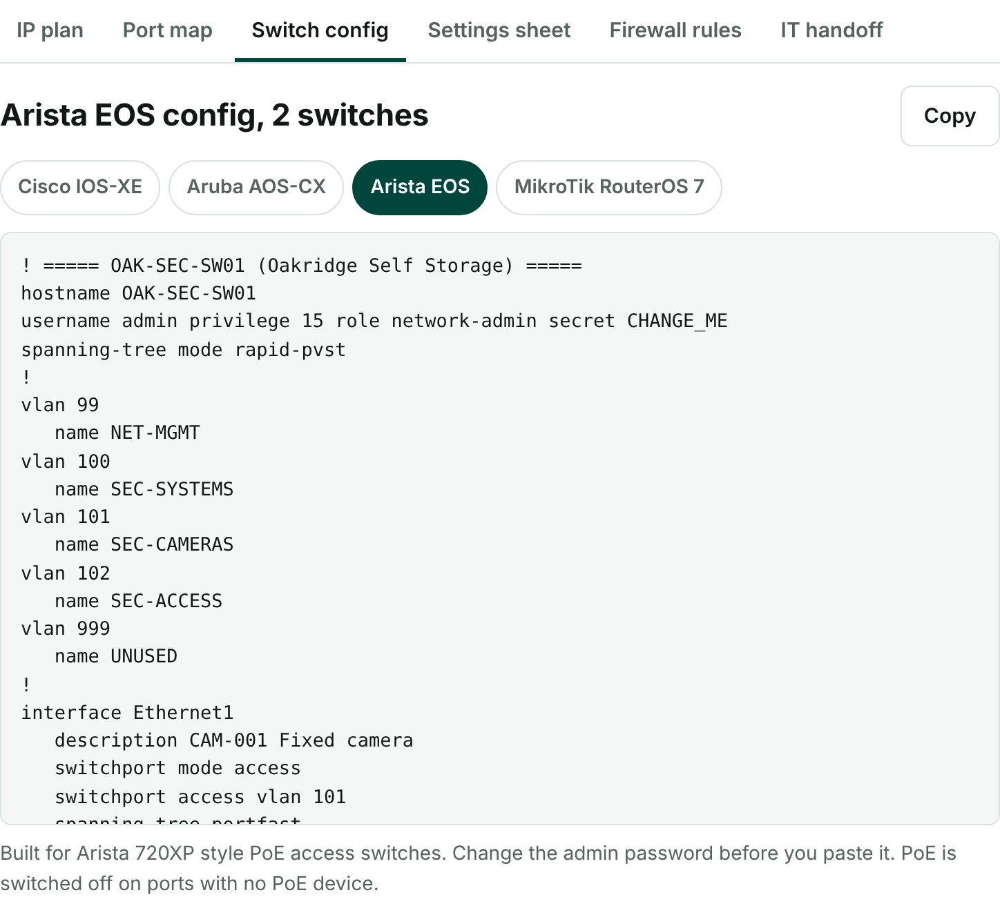
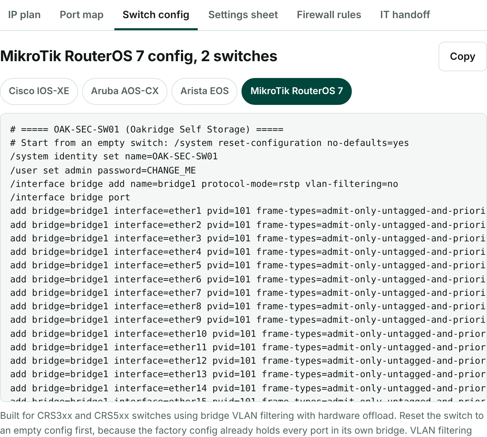
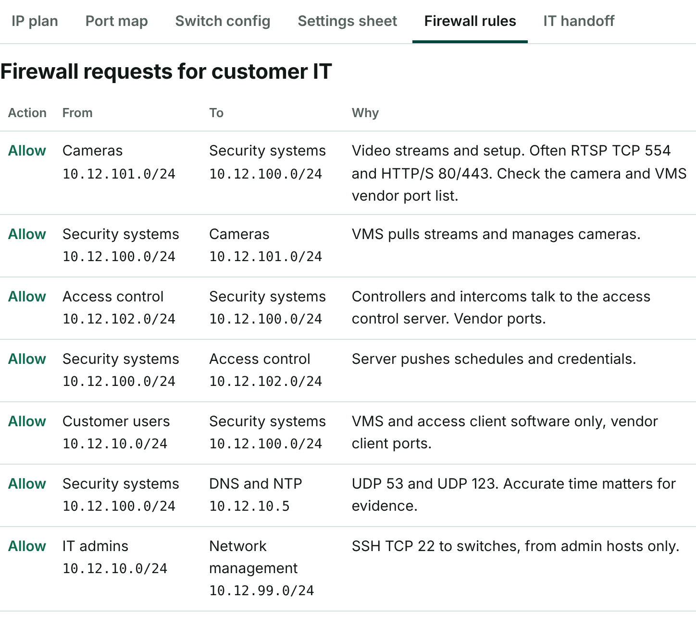
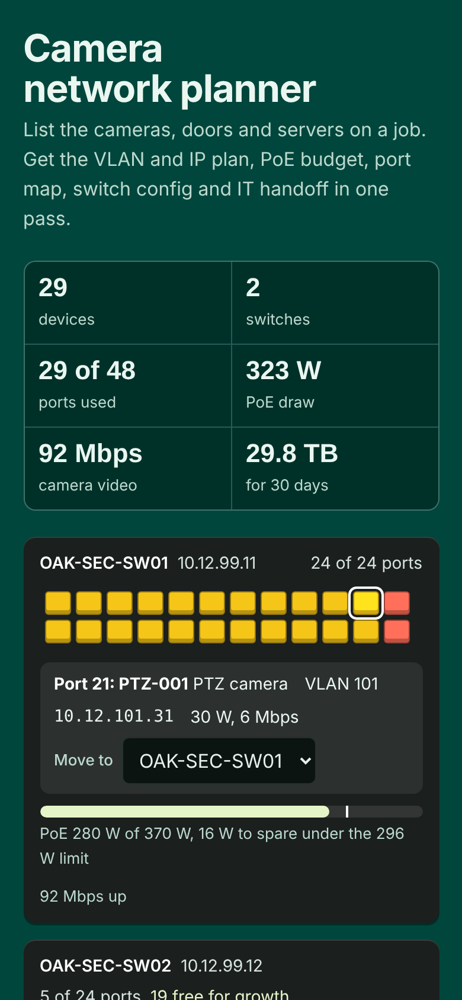

# Camera Network Planner

**List the cameras, doors and servers on a job. Get the whole network design back in seconds.**

A free, open-source planner for security, access control and AV integrators. It turns a device list into a VLAN and IP plan, a PoE-aware switch layout, a port map, paste-ready switch configs for four platforms, firewall requests, and a handoff document for the customer's IT team.

**[Try it in your browser](https://evilinhunter.github.io/camera-network-planner/)** · no install, no account, nothing leaves your machine

---

## Why

Camera and access control installers now build real networks, usually without a network engineer on the team. The questions are the same on every job:

- How many switches do I need before the PoE budget runs out?
- Which VLANs and subnets do I ask the customer's IT team for?
- What goes on which port, with which IP?
- What do I paste into the switch?
- What do I send IT so the firewall gets opened correctly the first time?

This tool answers all five from one device list.

## What you get

### 1. A switch layout that respects the PoE budget

Devices are packed onto switches until either the ports or your PoE limit runs out (80% of the budget by default), then the planner starts another switch. Every port is coloured by VLAN, and each switch shows its PoE draw against the limit and its estimated uplink traffic.

Tap any port to see its device, VLAN, IP and power draw, and move the device to another switch if you'd rather split things differently. Spare ports and spare PoE are shown on each switch, so you can tell the customer how much room there is to grow.

The planner warns you when a device needs more power than a port can supply, when a VLAN runs out of addresses, and when an uplink is over 70% full.

### 2. VLAN and IP plan

One /24 per role, using `10.<site>.<vlan>.0/24` so the VLAN ID matches the third octet and the scheme stays readable across sites.

### 3. Port and address schedule

Every device gets a name, switch, port, VLAN and IP, grouped by switch. This is your install sheet and your as-built record.

### 4. Paste-ready switch configs for four platforms

Pick a platform and the same design is written in its own syntax.

| Cisco IOS-XE | Aruba AOS-CX |
|---|---|
|  |  |
| **Arista EOS** | **MikroTik RouterOS 7** |
|  |  |

| Platform | Written for |
|---|---|
| Cisco IOS-XE | Catalyst 9200 and 9300 style access switches |
| Aruba AOS-CX | CX 6000, 6100 and 6200 |
| Arista EOS | 720XP PoE access switches |
| MikroTik RouterOS 7 | CRS3xx and CRS5xx, bridge VLAN filtering |

Using UniFi or another switch you set up through a web page? The **Settings sheet** tab lists the networks to create and the profile for each port range.

Hardening included in every config:

- Edge ports with PortFast or admin-edge, plus BPDU guard
- PoE switched off on ports with no PoE device
- Unused ports shut down and parked in an unused VLAN
- Uplink trunk carries only the security VLANs
- Management on its own VLAN, SSH only

### 5. Firewall requests for customer IT

A plain allow and deny list: cameras reach the recorder, users reach the VMS, and cameras never reach the internet or the business network.

### 6. An IT handoff you can paste into an email

VLANs, switches, firewall requests and the full device schedule in Markdown. Paste it into an email, a ticket or a doc.

### Works on a phone

Plan a job from the truck or the customer's parking lot.

## Quick start

1. Open the [live page](https://evilinhunter.github.io/camera-network-planner/), or download `index.html` and open it in any browser.
2. Fill in the job: site name, site number, and the customer's user subnet and DNS/NTP server.
3. Add your devices and quantities. Picking a type fills in typical watts and Mbps; replace them with the figures from each spec sheet.
4. Set your switch: platform, port count, PoE budget and maximum watts per port.
5. Read the warnings, then copy what you need from the tabs.

The browser remembers your job. **Save or load a job** copies a job out as text so you can keep it with the project files or send it to a colleague.

## Before you deploy

- **Check the config against your switch.** Syntax varies by model and software version. Review it, and test on one switch before you roll it out.
- **Use real numbers.** The default watts and bitrates are typical values, not measurements.
- **Check vendor ports.** Camera, VMS and access control ports vary. Compare the firewall requests with your vendor's port list.
- **Change every `CHANGE_ME`.**
- **MikroTik:** start from an empty switch (`/system reset-configuration no-defaults=yes`), because the factory config already holds every port in its own bridge. VLAN filtering and the unused-port shutdown come last, so paste the config from a console or a port you won't lose.

## How it works

One HTML file. No build step, no server, no dependencies, no tracking. All planning runs in your browser, so job details never leave your machine.

To host your own copy, fork the repo and turn on GitHub Pages: **Settings → Pages → Deploy from a branch → main / root**.

## Roadmap

- More platforms: UniFi API, Netgear AV line, Ruckus ICX, Aruba AOS-S
- Presets for common switch models (ports and PoE budget filled in for you)
- Presets for specific camera models, with watts and bitrates checked against spec sheets
- Import a device list from CSV or a VMS export
- Bigger sites: larger subnets and more than one camera VLAN
- PDF export of the handoff

## Contributing

Issues and pull requests are welcome. The most useful things you can send:

- A config that didn't paste cleanly, with your switch model and software version
- A platform you want supported, with a sample of a known-good access port and trunk config
- Real PoE and bitrate figures for devices you install often

## License

[MIT](LICENSE)
