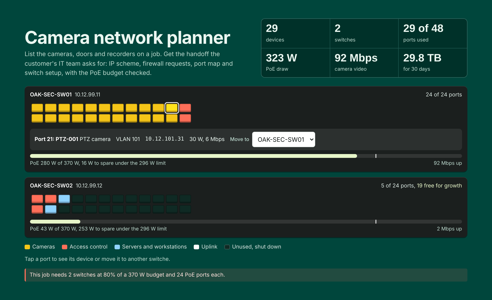
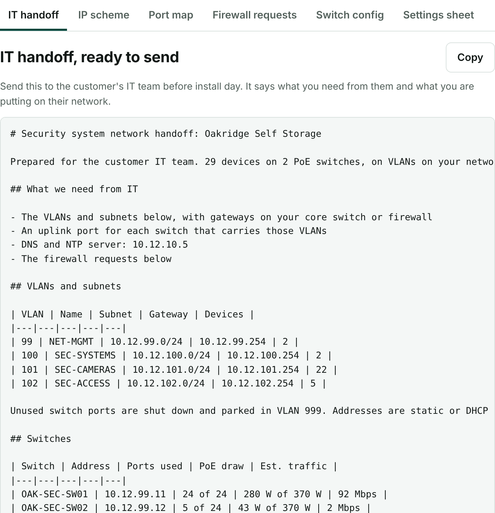
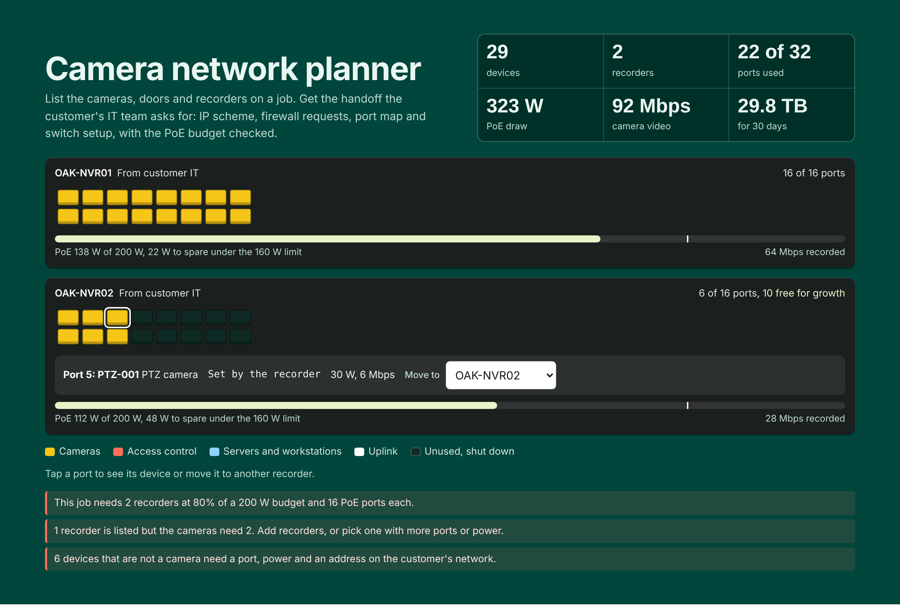
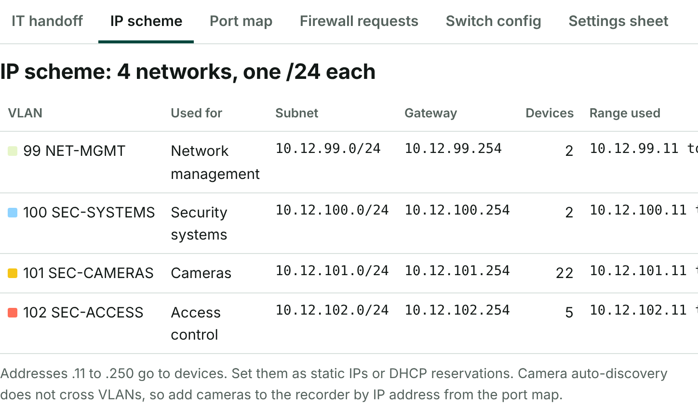
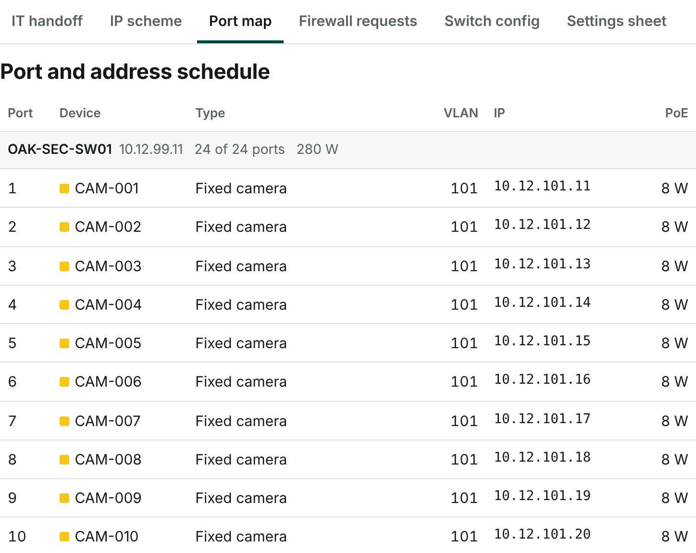
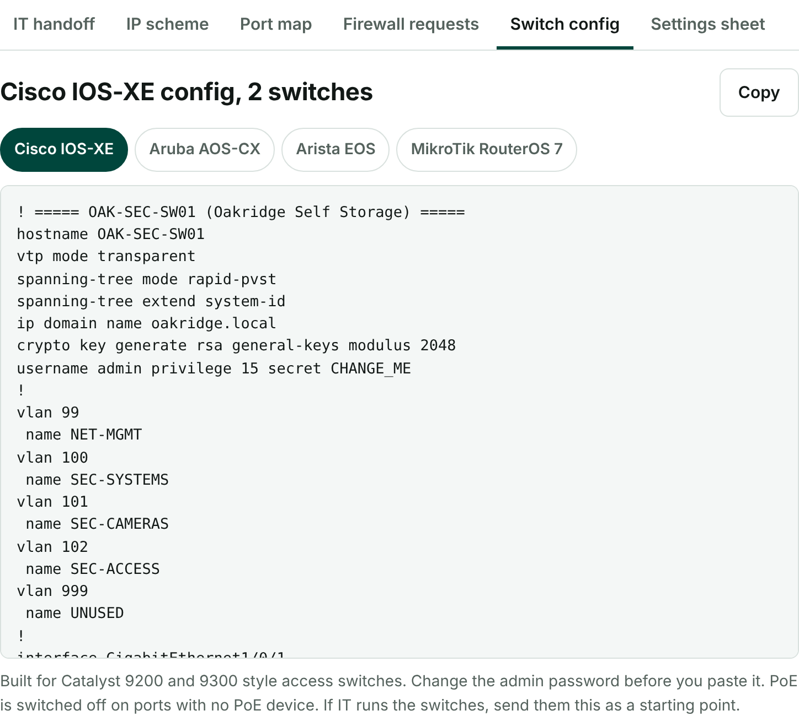
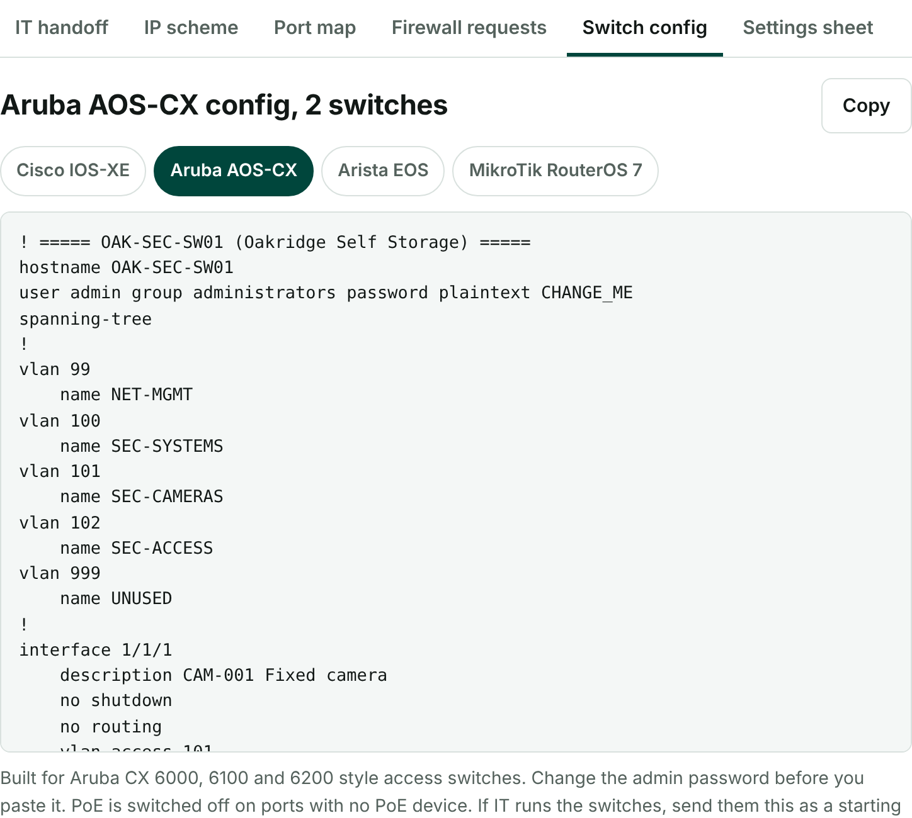

# Camera Network Planner

**List the cameras, doors and recorders on a job. Get the handoff the customer's IT team asks for, before install day.**

A free, open-source planner for security, access control and AV integrators. It turns a device list into an IT handoff document with the IP scheme, firewall requests and port map, checks the PoE budget, and writes the switch setup for four platforms.

It works for the three ways camera jobs get wired:

- **On the customer's network**, in VLANs that IT provides
- **On your own separate security network**
- **Straight into a PoE recorder (NVR)**, with no switch at all

**[Try it in your browser](https://evilinhunter.github.io/camera-network-planner/)** · no install, no account, nothing leaves your machine

---

## Why

Camera and access control installers now build real networks, usually without a network engineer on the team. The questions are the same on every job:

- What do I send IT so they say yes the first time?
- Which networks and addresses do I ask them for?
- How many switches or recorders do I need before the PoE budget runs out?
- What goes on which port, with which IP?
- What gets set on the switch?

This tool answers all five from one device list.

## What you get

### 1. An IT handoff you can send before install day

It opens with what you need from IT, then lists the networks, switches or recorders, firewall requests, remote access rules and the full device schedule. It's written in Markdown, so it pastes into an email, a ticket or a doc.

### 2. A PoE check you can see

Devices are packed onto switches, or recorder PoE ports, until the ports or your PoE limit run out (80% of the budget by default). Every port is coloured by what's plugged into it, and each unit shows its PoE draw against the limit.

Tap any port to see its device, address and power draw, and move the device somewhere else if you'd rather split things differently. Spare ports and spare PoE are shown, so you can tell the customer how much room there is to grow.

The planner warns you when a device needs more power than a port can supply, when a network runs out of addresses, and when an uplink is over 70% full.

Plugging cameras straight into a recorder? Pick that option and the planner checks the recorder's ports and PoE budget, and tells IT exactly how many addresses you need.

### 3. IP scheme

One /24 per network, using `10.<site>.<vlan>.0/24` so the VLAN ID matches the third octet and the scheme stays readable across sites. On a separate security network it's a single subnet.

### 4. Port and address schedule

Every device gets a name, port and IP, grouped by switch or recorder. This is your install sheet and your as-built record.

### 5. Firewall requests

A plain allow and block list: cameras reach the recorder, users reach the viewing software, cameras never reach the internet or the business network, and nothing is port-forwarded from the internet.

### 6. Switch setup for four platforms

Pick a platform and the same design is written in its own syntax. If IT runs the switches, send it to them as a starting point.

| Cisco IOS-XE | Aruba AOS-CX |
|---|---|
|  |  |
| **Arista EOS** | **MikroTik RouterOS 7** |
|  |  |

| Platform | Written for |
|---|---|
| Cisco IOS-XE | Catalyst 9200 and 9300 style access switches |
| Aruba AOS-CX | CX 6000, 6100 and 6200 |
| Arista EOS | 720XP PoE access switches |
| MikroTik RouterOS 7 | CRS3xx and CRS5xx, bridge VLAN filtering |

Using UniFi or another switch you set up in a web page? The **Settings sheet** tab lists the networks to create and the profile for each port range.

Built into every config:

- Edge ports with PortFast or admin-edge, plus BPDU guard
- PoE switched off on ports with no PoE device
- Unused ports shut down and parked in an unused VLAN
- The uplink carries only the security VLANs
- Switch management on SSH only

### Works on a phone

Plan a job from the truck or the customer's parking lot.

## Quick start

1. Open the [live page](https://evilinhunter.github.io/camera-network-planner/), or download `index.html` and open it in any browser.
2. Pick how the cameras connect, then fill in the site name, site number, and the customer's user subnet and DNS/NTP server.
3. Add your devices and quantities. Picking a type fills in typical watts and Mbps; replace them with the figures from each spec sheet.
4. Set your switch or recorder: port count, PoE budget and maximum watts per port.
5. Read the warnings, then copy what you need from the tabs.

The browser remembers your job. **Save or load a job** copies a job out as text so you can keep it with the project files or send it to a colleague.

## Before you deploy

- **Check the config against your switch.** Syntax varies by model and software version. Review it, and test on one switch before you roll it out.
- **Use real numbers.** The default watts and bitrates are typical values, not measurements.
- **Check vendor ports.** Camera, VMS and access control ports vary. Compare the firewall requests with your vendor's port list.
- **Change every `CHANGE_ME`.**
- **MikroTik:** start from an empty switch (`/system reset-configuration no-defaults=yes`), because the factory config already holds every port in its own bridge. VLAN filtering and the unused-port shutdown come last, so paste the config from a console or a port you won't lose.

## How it works

One HTML file. No build step, no server, no dependencies, no tracking. All planning runs in your browser, so job details never leave your machine.

To host your own copy, fork the repo and turn on GitHub Pages: **Settings → Pages → Deploy from a branch → main / root**.

## Roadmap

- More platforms: UniFi API, Netgear AV line, Ruckus ICX, Aruba AOS-S
- Presets for common switch models (ports and PoE budget filled in for you)
- Presets for specific camera models, with watts and bitrates checked against spec sheets
- Import a device list from CSV or a VMS export
- Bigger sites: larger subnets and more than one camera VLAN
- PDF export of the handoff

## Contributing

Issues and pull requests are welcome. The most useful things you can send:

- A config that didn't paste cleanly, with your switch model and software version
- A platform you want supported, with a sample of a known-good access port and trunk config
- Real PoE and bitrate figures for devices you install often

## License

[MIT](LICENSE)
